# Kadence — Data Requirements Analysis (Step 1.1)

Sources analyzed:

- **Figma design:** `Kadence` file, pages Log-In, Dashboard, To-Do List, Goal Breakdown, Priority setter, Goal Page, Visual Planner (Add Task, Edit Task, week view), Settings, Dark mode.
- **User stories:** `User Stories List.pdf` (15 stories with acceptance criteria and developer tasks).
- **Source code:** `src/*.tsx` (React/TypeScript/Vite, no backend; everything is in-memory except the theme in `localStorage`).

**Decision recorded:** Tasks (`Task`, To-Do / Priority / Weekly Review) and Planner events (`PlannerEvent`, Visual Planner) stay **separate entities for now**. Revisit later.

**Implementation note (Step 1.2):** the Prisma model in `prisma/schema.prisma` refines this analysis. Times of day are stored as minutes since midnight instead of `TIME`, deleting a parent goal sets children's `parent_goal_id` to NULL, and `Category` was not created. See [database.md](database.md#ai-generated-design-decisions-reviewed-and-corrected-by-the-team).

---

## 1. What needs persistent storage

| Feature | Where it appears | Persist? | Entity |
|---|---|---|---|
| Account, login, change password | Login page, Settings > Privacy | Yes | `User` |
| Profile (name, school, major, graduation, career interests/goals, avatar) | Settings > Profile | Yes | `User` |
| Theme, accent, planner view, week start, time format, landing page | Settings > Planner appearance | Yes | `UserSettings` |
| Reminder toggles, quiet hours | Settings > Notifications | Yes | `UserSettings` |
| Reminder frequency per priority, delivery method | Story: reminder aggressiveness | Yes | `PriorityReminderRule` |
| Per-task reminder level | Story: reminder aggressiveness | Yes | `Task`, `PlannerEvent` |
| Goal defaults and tracking prefs | Settings > Goal-setting | Yes | `UserSettings` |
| Unfinished-task rules, daily limit | Settings > Unfinished tasks | Yes | `UserSettings` |
| Weekly review day/time/content | Settings > Weekly reviews | Yes | `UserSettings` |
| Backup, auto-delete completed | Settings > Privacy | Yes | `UserSettings` |
| To-do tasks (title, category, priority, due date, completion) | To-Do List | Yes | `Task` |
| Priority changes on tasks and goals | Priority setter, Goal Breakdown | Yes (a field, no new table) | `Task.priority`, `Goal.priority` |
| Goals in three tiers, parent/child links, dates, priority | Goals, Goal Breakdown | Yes | `Goal` |
| Milestones with due and completion dates | Goal Breakdown | Yes | `Milestone` |
| Planner events (date, hour, duration, status, notes, link) | Visual Planner | Yes | `PlannerEvent` |
| Repeating tasks and events | Story: reschedule missed tasks | Yes | `RecurrenceRule` |
| Open time-slot windows for rescheduling | Story: reschedule missed tasks | Yes | `AvailabilityWindow` |
| Exam flag and generated study sessions | Story: exam study time | Yes | fields on `Task`, `PlannerEvent` |
| Notifications that link to a task or event | Story: reminders | Yes | `Notification` |
| Simple vs advanced dashboard, tab sizes/order | Stories: simple main screen, resize tabs | Yes (preference) | `UserSettings` |
| Weekly review reflections/snapshots | Settings > Weekly reviews | Optional | `WeeklyReview` |

**Not stored (derived or UI state):**

- Weekly Review counts and percentages (computed from `Task`).
- Goal progress, "6 of 10 milestones", "Linked to: X" text, "Your progress" counts, "In progress" badge (computed from goals, milestones and tasks).
- Upcoming-deadline list in the notification bell (computed from due dates; only *scheduled reminders* are stored).
- Search text, open menus, selected row, announcement text, current week being viewed.
- Hard-coded demo values in the design: "Thursday, October 8", "AL" initials (from `User`), "62% progress this month" (computed), "October intention" (static copy).

---

## 2. Entities, attributes and constraints

Types are generic SQL; pick the final engine later. `PK` = primary key, `FK` = foreign key.

### 2.1 `User`

| Attribute | Type | Constraints |
|---|---|---|
| id | UUID | PK |
| username | VARCHAR(50) | NOT NULL, UNIQUE |
| email | VARCHAR(255) | NOT NULL, UNIQUE, valid format |
| password_hash | VARCHAR(255) | NOT NULL (never store plaintext) |
| first_name, last_name | VARCHAR(100) | nullable |
| school, major | VARCHAR(150) | nullable |
| graduation_date | DATE | nullable (UI shows MM / YYYY) |
| career_interests, career_goals | TEXT | nullable |
| avatar_url | VARCHAR(500) | nullable (store a file reference, not base64) |
| created_at | TIMESTAMP | NOT NULL |

### 2.2 `UserSettings` (1:1 with `User`)

`user_id` is both PK and FK, `ON DELETE CASCADE`.

| Group | Attributes (type, allowed values / default) |
|---|---|
| Appearance | `theme` ENUM(Light, Dark, System) default Light; `accent` CHAR(7) hex default `#406b51`; `planner_view` ENUM(Daily, Weekly, Monthly); `week_start` ENUM(Sunday, Monday, Saturday); `time_format` ENUM(12h, 24h); `landing_page` ENUM(Dashboard, Planner, Goals) |
| Dashboard | `dashboard_mode` ENUM(Simple, Advanced) default Simple; `tab_layout` JSON nullable (tab order, widths) |
| Reminders | `remind_daily_planning`, `remind_upcoming`, `remind_deadline`, `remind_goal_progress`, `remind_weekly_review`, `remind_missed_goal` (BOOLEAN default true); `quiet_start`, `quiet_end` TIME nullable |
| Goal defaults | `goal_timeframe` ENUM(Daily, Weekly, Monthly, Yearly); `goal_category` ENUM(Academic, Career, Personal development); `goal_breakdown` ENUM(Major milestones, Daily, Weekly, Manual); `goal_priority` (same enum as `priority`); `celebration` ENUM(Message, Animation, Off); `progress_metric` ENUM(Percent, Tasks, Milestones, Time) |
| Unfinished tasks | `unfinished_behavior` ENUM(Ask, Move to next day, Keep on original date, Move to backlog); `unfinished_review_time` ENUM(End of day, Start of next day, Weekly review, Never); `deadline_handling` ENUM(Auto-update, Keep original, Ask); `auto_reschedule` BOOLEAN; `reschedule_high_only` BOOLEAN; `reschedule_exclude_overdue` BOOLEAN; `daily_limit` SMALLINT CHECK 0–20 default 3; `warn_overload` BOOLEAN; `reprioritize_when_full` BOOLEAN |
| Weekly review | `review_day` SMALLINT 0–6; `review_reminder` BOOLEAN; `review_time` TIME; `review_summary_items` JSON (subset of: Tasks completed, Goals completed, Milestones reached, Time spent, Completion rate); `reflection_questions` BOOLEAN; `missed_goal_handling` ENUM(Keep, Reschedule, Revise, Archive); `visualization` ENUM(Charts, Progress bars, Percentages) |
| Study sessions | `study_days_before_exam` SMALLINT; `study_session_hours` SMALLINT CHECK 1–8; `study_sessions_per_day` SMALLINT; `study_window_start_hour`, `study_window_end_hour` SMALLINT 0–24 |
| Privacy | `backup` ENUM(Automatic, Manual, Off); `delete_completed` BOOLEAN; `delete_completed_after_days` SMALLINT (the design says "after a set period" but never defines it) |

### 2.3 `PriorityReminderRule`

Reminder frequency by priority ("maybe the ability to set frequencies based on priority") and how reminders are delivered.

| Attribute | Type | Constraints |
|---|---|---|
| id | UUID | PK |
| user_id | UUID | FK → User, CASCADE |
| priority | ENUM(Very High, High, Medium, Low, Very Low, None) | NOT NULL |
| reminders_per_day | SMALLINT | CHECK 0–24 |
| channel | ENUM(In-app, Email, Push) | NOT NULL, default In-app |
| | | UNIQUE (user_id, priority) |

### 2.4 `Goal`

| Attribute | Type | Constraints |
|---|---|---|
| id | UUID | PK |
| user_id | UUID | FK → User, CASCADE |
| parent_goal_id | UUID | FK → Goal, nullable (self-reference) |
| title | VARCHAR(150) | NOT NULL, not blank after trim |
| size | ENUM(Big, Medium, Small) | NOT NULL (the "tier" in the Goals board) |
| category | ENUM(Academic, Career, Personal development) | nullable |
| description | TEXT | nullable |
| priority | ENUM(Very High … None) | NOT NULL default None |
| start_date | DATE | nullable ("Begin date" in the Breakdown design) |
| target_date | DATE | nullable, CHECK ≥ start_date |
| status | ENUM(Active, Completed, Archived) | NOT NULL default Active |
| completed_at | TIMESTAMP | set only when status = Completed |
| created_at | TIMESTAMP | NOT NULL |

Rules:

- A parent must be a larger tier than its child (Big → Medium → Small).
- A goal cannot be its own ancestor.
- Progress is computed, never stored (see §4).

### 2.5 `Milestone`

The "Milestones" list on the Goal Breakdown page. Each has a completion date or a due date.

| Attribute | Type | Constraints |
|---|---|---|
| id | UUID | PK |
| goal_id | UUID | FK → Goal, CASCADE, NOT NULL |
| title | VARCHAR(150) | NOT NULL |
| due_date | DATE | nullable ("Milestones can be scheduled onto specific dates") |
| completed_at | TIMESTAMP | nullable; completed ⇔ not null |
| sort_order | SMALLINT | NOT NULL |

### 2.6 `Task` (To-Do, Priority setter, Weekly Review)

| Attribute | Type | Constraints |
|---|---|---|
| id | UUID | PK |
| user_id | UUID | FK → User, CASCADE |
| goal_id | UUID | FK → Goal, nullable, `ON DELETE SET NULL` ("Individual tasks" have none) |
| title | VARCHAR(200) | NOT NULL, not blank after trim |
| category | VARCHAR(50) | NOT NULL default General (free text today: Study, Coding, Career, Fitness) |
| priority | ENUM(Very High … None) | NOT NULL default None |
| due_date | DATE | nullable |
| original_due_date | DATE | nullable (keep the original deadline visible after rescheduling) |
| completed | BOOLEAN | NOT NULL default false |
| completed_date | DATE | set only when completed = true |
| is_exam | BOOLEAN | NOT NULL default false (exam flag for study scheduling) |
| reminders_per_day | SMALLINT | nullable, CHECK 0–24; NULL = use the `PriorityReminderRule` default |
| backlog | BOOLEAN | NOT NULL default false ("Move to a task backlog") |
| recurrence_rule_id | UUID | FK → RecurrenceRule, nullable |
| series_id | UUID | nullable; groups clones of a repeating task |
| created_at | TIMESTAMP | NOT NULL |

### 2.7 `PlannerEvent` (Visual Planner, Add Task, Edit Task)

| Attribute | Type | Constraints |
|---|---|---|
| id | UUID | PK |
| user_id | UUID | FK → User, CASCADE |
| goal_id | UUID | FK → Goal, nullable, SET NULL |
| linked_event_id | UUID | FK → PlannerEvent, nullable, SET NULL ("Connect to" a linked task) |
| source_task_id | UUID | FK → Task, nullable, SET NULL (set when generated as a study session for an exam) |
| title | VARCHAR(200) | NOT NULL, not blank after trim |
| category | ENUM(Personal, Focus, Wellbeing, Work) | NOT NULL |
| task_type | ENUM(Project, Task, Habit) | NOT NULL default Project |
| goal_size | ENUM(Small, Medium, Big) | NOT NULL default Medium |
| priority | ENUM(Very High … None) | NOT NULL default None (**new:** needed for the calendar priority filter story) |
| status | ENUM(Not started, In progress, Done) | NOT NULL default Not started |
| event_date | DATE | NOT NULL (labeled "Due Date" on Add, "Date" on Edit) |
| original_event_date | DATE | nullable |
| start_hour | SMALLINT | CHECK 0–23 |
| duration_hours | SMALLINT | CHECK 1–24 and `start_hour + duration_hours ≤ 24` |
| description, notes | TEXT | nullable |
| reminders_per_day | SMALLINT | nullable, CHECK 0–24 |
| recurrence_rule_id | UUID | FK → RecurrenceRule, nullable |
| series_id | UUID | nullable |
| created_at | TIMESTAMP | NOT NULL |

Rules:

- `linked_event_id` cannot equal `id`.
- Rescheduled events must not overlap another event for the same user (enforced in application logic or an exclusion constraint).

### 2.8 `RecurrenceRule`

Repeated items are stored as separate rows (clones of the original except the date), grouped by `series_id`.

| Attribute | Type | Constraints |
|---|---|---|
| id | UUID | PK |
| user_id | UUID | FK → User, CASCADE |
| frequency | ENUM(Daily, Weekly, Monthly) | NOT NULL |
| interval_count | SMALLINT | CHECK ≥ 1 default 1 |
| weekdays | SMALLINT (bitmask) | nullable; used when Weekly |
| ends_on | DATE | nullable |
| max_occurrences | SMALLINT | nullable; at most one of `ends_on` / `max_occurrences` |

### 2.9 `AvailabilityWindow`

User-defined open time slots used when redistributing missed tasks.

| Attribute | Type | Constraints |
|---|---|---|
| id | UUID | PK |
| user_id | UUID | FK → User, CASCADE |
| weekday | SMALLINT | CHECK 0–6 |
| start_time, end_time | TIME | NOT NULL, CHECK start_time < end_time |

### 2.10 `Notification`

Stored so a notification can link to its task or event, be read or unread, and respect reminders per day and quiet hours.

| Attribute | Type | Constraints |
|---|---|---|
| id | UUID | PK |
| user_id | UUID | FK → User, CASCADE |
| task_id | UUID | FK → Task, nullable, CASCADE |
| planner_event_id | UUID | FK → PlannerEvent, nullable, CASCADE |
| type | ENUM(Daily planning, Upcoming task, Deadline, Goal progress, Weekly review, Missed goal) | NOT NULL |
| channel | ENUM(In-app, Email, Push) | NOT NULL |
| scheduled_for | TIMESTAMP | NOT NULL |
| delivered_at, read_at | TIMESTAMP | nullable |
| | | CHECK: not both `task_id` and `planner_event_id` set |

### 2.11 `WeeklyReview` (optional)

Only needed if reflection answers or weekly snapshots are saved. Today the review is fully derived.

| Attribute | Type | Constraints |
|---|---|---|
| id | UUID | PK |
| user_id | UUID | FK → User, CASCADE |
| week_start | DATE | NOT NULL, UNIQUE (user_id, week_start) |
| reflection | TEXT | nullable |
| completed_count, pending_count, overdue_count | SMALLINT | snapshot at review time |
| reviewed_at | TIMESTAMP | nullable |

---

## 3. Relationships

```mermaid
erDiagram
    USER ||--|| USER_SETTINGS : has
    USER ||--o{ PRIORITY_REMINDER_RULE : configures
    USER ||--o{ AVAILABILITY_WINDOW : defines
    USER ||--o{ GOAL : owns
    USER ||--o{ TASK : owns
    USER ||--o{ PLANNER_EVENT : owns
    USER ||--o{ RECURRENCE_RULE : defines
    USER ||--o{ NOTIFICATION : receives
    USER ||--o{ WEEKLY_REVIEW : writes
    GOAL ||--o{ GOAL : "parent of"
    GOAL ||--o{ MILESTONE : contains
    GOAL |o--o{ TASK : groups
    GOAL |o--o{ PLANNER_EVENT : groups
    PLANNER_EVENT |o--o{ PLANNER_EVENT : "linked to"
    TASK |o--o{ PLANNER_EVENT : "study sessions for"
    RECURRENCE_RULE |o--o{ TASK : repeats
    RECURRENCE_RULE |o--o{ PLANNER_EVENT : repeats
    TASK |o--o{ NOTIFICATION : triggers
    PLANNER_EVENT |o--o{ NOTIFICATION : triggers
```

| Relationship | Cardinality | Delete behavior |
|---|---|---|
| User → UserSettings | 1 : 1 | cascade |
| User → Goal / Task / PlannerEvent / Notification / etc. | 1 : many | cascade (account deletion removes everything, as the Settings page promises) |
| Goal → Goal (parent/child) | 1 : many, self | restrict or cascade (team decision) |
| Goal → Milestone | 1 : many | cascade |
| Goal → Task, Goal → PlannerEvent | 0..1 : many | set null |
| PlannerEvent → PlannerEvent (linked) | 0..1 : many, self | set null |
| Task → PlannerEvent (study sessions) | 0..1 : many | set null |
| RecurrenceRule → Task / PlannerEvent | 0..1 : many | set null |
| Task / PlannerEvent → Notification | 0..1 : many | cascade |

---

## 4. Derived data and the rules behind it

- **Goal progress** (story: "automatic progress calculation", "progression of small goals also progresses larger connected goals"): a goal's progress is computed from its completed milestones, child goals and linked tasks and rolls up through `parent_goal_id`. Display follows `UserSettings.progress_metric`. It is not stored, so it cannot drift.
- **"Time spent" metric**: nothing in the design records time spent. It would have to be derived from `PlannerEvent.duration_hours` of Done events, or a time-tracking table added later (see open questions).
- **Weekly Review**: completed, pending and overdue tasks for the current week, computed from `Task.completed_date` and `Task.due_date`.
- **Missed/overdue detection** (story: "hourly or upon opening"): `due_date < today AND completed = false`; no extra storage needed.
- **Study sessions** (story: exam prep): generated `PlannerEvent` rows with `source_task_id` = the exam task, placed in the days before `due_date` using the `study_*` settings.
- **Priority filter on calendar**: UI selection, default all levels; only persist it if the team wants it remembered.

---

## 5. Constraints summary

- Titles are required and not blank after trimming.
- The six priority levels are one shared enum: Very High, High, Medium, Low, Very Low, None.
- Status is Not started, In progress or Done; `completed_at` / `completed_date` is set only when done.
- `start_hour` is 0–23 and `start_hour + duration_hours ≤ 24`.
- Parent goal tier must be larger than child tier; no cycles.
- `target_date ≥ start_date`.
- `reminders_per_day` is 0–24 (NULL means inherit from the priority rule).
- `daily_limit` is 0–20.
- `quiet_start` / `quiet_end` are both set or both null.
- `AvailabilityWindow.start_time < end_time`.
- `username` and `email` are unique; passwords are stored only as hashes.
- Recurrence ends by date or by count, not both.

---

## 6. Gaps and inconsistencies found

1. **Goal Breakdown design shows both a Milestones list and a Connected Goals panel.** They are different things, so `Milestone` is its own entity. (An earlier draft suggested modeling milestones as child goals; the Figma design and stories point to a separate entity.)
2. **The Breakdown design needs `start_date` and a status badge** ("Begin date", "Target end date", "In progress"). The code's `Goal` only has `targetDate`. The code's Breakdown tab currently shows the Weekly Review instead of the goal breakdown, so the goal breakdown page in the design is not implemented in code yet.
3. **Story "Goal Breakdown page" says goals link "inside and outside of the same tier".** `parent_goal_id` covers parent/child. If peer links (same tier) are really needed, add a `GoalLink(goal_id, linked_goal_id)` join table.
4. **`PlannerEvent` has no priority in code, but the calendar priority filter story needs one.** Added `priority`.
5. **The Priority setter says "tasks and goals" but only edits tasks in code.** The goal priority story needs it on `Goal` too (field already exists).
6. **Two different "category" lists:** Task category is free text, planner category is a fixed 4-value enum, goal category (Settings) has 3 values, and "Goal size" is a separate concept. Kept separate; a shared `Category` table is a candidate for the later merge review.
7. **Settings "default priority" offers only Low/Medium/High**, while the rest of the app uses six levels. Using the shared enum is recommended.
8. **Login uses a username, Settings collects an email.** Both are stored as unique; choose one as the sign-in identifier.
9. **The To-Do Figma page has a monthly calendar summary** that the code removed (commit "remove calendar view"). No extra data is needed: it reads from the same task and event dates.
10. **Hard-coded dates:** planner sample data is August 2023; the dashboard shows a fixed date. These are demo values only.
11. **Auto-delete of completed tasks has no defined period** (added `delete_completed_after_days`; the team needs to pick a default).
12. **Avatar is a base64 data URL in code**; store a file reference in the database.

---

## 7. Open questions for the team

1. Are same-tier goal links needed (`GoalLink`), or is parent/child enough?
2. Should milestones link to specific `PlannerEvent`s or tasks when scheduled, or is `Milestone.due_date` enough?
3. Is "Time spent" a real metric? If so, do we derive it from planner durations or add a time-tracking table?
4. Do notifications need email/push delivery, or in-app only? (This decides whether `channel` is needed.)
5. Should recurring items be pre-generated for a fixed horizon, or created on demand as each occurrence approaches?
6. Which field identifies the user at sign-in: username or email?
7. When Tasks and PlannerEvents are revisited, should they merge into one table? Evidence for it: the planner's "Due Date" field, priority sync, and shared reminder/recurrence fields.
8. Do we persist the saved UI preferences (priority filter selection, tab widths) or only the dashboard simplicity mode?
